# VOLLEY Gen5 — paper and reproducibility package

### A system-level computational design study of a programmable electromagnetic CubeSat deployer

This repository is the **standalone companion** to an [IEEE-formatted manuscript](paper/VOLLEY_IEEE_Conference.pdf). It includes the manuscript source, cited local figures, CAD, analysis code and outputs, validation records, assumptions and known defects. A reader can evaluate the paper from this repository alone.

> **Initial Gen6 mixed-size policy screen, P129:** The selected service case is two ordinary passive 1U plus two 3U spacecraft from a rideshare/OTV host, released within one orbit from a 500 km sun-synchronous surrogate. Success is a distinct full position/velocity state for each satellite 24 hours after the last release; host maneuvers are allowed and counted on both sides. The [J2 full-state screen](validation/P129_gen6_mixed_mission.md) constructs four transparent trial targets and shows that simple VOLLEY and spring/host policies both accumulate terminal-state error. It is **not** an optimized campaign or evidence that VOLLEY wins. [Requirements revision 1](docs/GEN6_G0_MISSION_AND_ARTICLE_REQUIREMENTS.md) · [source](analysis/gen6_mixed_mission.py) · [result](analysis/results/gen6_mixed_mission.json) · [figure](figures/gen6_mixed_mission.svg). No Gen6 hardware is built or funded. This is a post-manuscript future-work supplement; the released Gen5 PDF is not a Gen6 design claim.

> **Current Gen6 Go 1 matched campaign, P130:** A public [1U/3U and dispenser reference audit](docs/GEN6_GO1_PUBLIC_REFERENCE_AUDIT.md) distinguishes form-factor precedents from a provider-approved interface. The [matched four-release J2 construction](validation/P130_gen6_matched_campaign.md) lets **both** commanded release and spring-plus-host reach all four target position/velocity states using the same ideal host-burn schedule. At assumed 30 kg versus 16 kg device masses, commanded release saves 3.2823 kg of host fuel but carries a 14 kg device premium; no installed-mass benefit is established. A +0.1 m/s release-speed error shifts the one-day terminal position by roughly 25–27 km. [Source](analysis/gen6_matched_campaign.py) · [result](analysis/results/gen6_matched_campaign.json) · [figure](figures/gen6_matched_campaign.svg). The targets, device masses, host and release range are surrogates; there is no customer tolerance, selected hardware or flight interface. This is a post-manuscript future-work supplement; the released Gen5 PDF is unchanged.

> **Gen6 Go 2 engineering screen, P131:** Two native [FreeCAD first-article assemblies and STEP exports](cad/gen6_first_article/README.md) compare captured permanent-magnet and conductive-plate carriers for a passive 4 kg 3U dummy. Both clear five nominal travel stations, but their frame, guide and carrier material proxies already total **9.926/9.945 kg**. Only about **9.35 kg** remains under P130's surrogate mass-parity proxy for the unmodeled drive, source, brake, restraint and controls. At 6 m/s the ideal moving-energy floor is about **82 J**. [P131 calculations and tolerance failure](validation/P131_gen6_go2_article_bounds.md) · [G1 decision](docs/GEN6_GO2_ARCHITECTURE_SCREEN.md) · [source](analysis/gen6_go2_article_bounds.py). **Neither candidate is selected or released for construction.** [P132 source and instrument screen](validation/P132_gen6_go2_power_instrument_screen.md) adds a 6 m/s **818 J** bus-energy floor at an assumed 10% efficiency, an ideal 0.406 F 96-to-72 V capacitance floor, and an illustrative two-gate timing budget. No winding, source or sensor is selected. This future-work supplement does not alter the released Gen5 manuscript PDF.


*Geometry review from FreeCAD solids; the drive and brake are unrated space envelopes.*

> **Earlier four-identical-3U G0 screen, P128:** The previous requirements screen declares a four-payload 4 kg 3U, 450 km surrogate with 5–20 km immediate semimajor-axis-rise targets. The [P128 reproducible calculation](validation/P128_gen6_g0_reference.md) needs 2.795–11.149 m/s ideal prograde increments; a 3–6 m/s single-payload first article would measure the mechanism, not complete the 20 km no-burn target. The one-event spring/host mass proxy permits roughly 24.08–24.55 kg of total deployer mass at 3–6 m/s for resource parity under its assumptions. **That earlier G0 is partial and not passed:** there is no named buyer, spacecraft, provider interface, full-state campaign or selected Gen6 hardware. [Source](analysis/gen6_g0_reference.py) · [JSON](analysis/results/gen6_g0_reference.json) · [figure](figures/gen6_g0_reference.svg). This is a post-manuscript future-work supplement; the released Gen5 PDF is not a Gen6 design claim.

> **Publication state, October 2026:** The paper is **not submitted or peer reviewed**. No IEEE venue has been selected, so venue-specific page, abstract, reference and copyright requirements have not been checked. Gen5 is a controlled computational evaluation snapshot. Gen6 is the proposed first mission-derived instrumented prototype programme; 1 km/s-class release is separate long-range research. No VOLLEY hardware has been built, fired, measured, qualified or flown.


*Conceptual motion from the local [FreeCAD-linked STEP review solids](cad/renders/sequence/README.md). The enclosure and near cassette shell are hidden. The evaluated reference placement has a known side-fed track/cassette clash; moving clearances, contact and brake behavior are unverified. [Watch the eight-second sequence](cad/renders/sequence/gen5_intended_sequence.mp4) · [view the static STEP audit](cad/renders/step_review/README.md). This is graphical orientation for the paper, not added performance evidence.*

<p align="center"></p>

> **Performance correction under review:** a finite-geometry analytic 3-D force integral finds **12.448 m/s only under ideal phase with circuit losses omitted**. This challenges the historical periodic-force shot result of **16.029 m/s**. The latter remains in the paper as a traceable model output, not an established machine capability. [Numerical run sheet](validation/P118_gen5_finite_force_map.md) · [affected-claim disposition](docs/GEN5_2026_10_09_FINDING_DISPOSITION.md).

An independent [2-D finite-element screen](validation/P119_gen5_finite_force_fem2d.md) reproduces the finite-array force decline with **1,081.6 J ideal in-plane work** on a 1 mm mesh; the analytic 3-D model gives 1,041.7 J. A [finite-force shot rerun](validation/P120_gen5_finite_coupled_shot.md) gives 12.448 m/s and 2.099 kJ gross draw under the historical bank and full-winding assumptions. A second [depth-resolved 3-D surface-charge implementation](validation/P121_gen5_finite_force_surface3d.md) independently recovers **1,041.7 J** under shared ideal assumptions. An [illustrative gap sweep](validation/P122_gen5_finite_force_sensitivity.md) gives **906.7 J at 14 mm**, 13.0% below the 12 mm case. Selected power hardware, contact and physical validation remain open.

> **Updated manuscript result, 10 October 2026:** [P123](validation/P123_gen5_one_event_mass_screen.md) re-solves the matched one-release reference with fuel sized for that event. Gen5 saves 1.866 kg of fuel when both options start with 10 kg, yet its modeled dry device is 54.562 kg heavier. The self-consistent one-event device-plus-fuel proxy is **52.717 kg worse** than the spring class. Parity at the *ideal* P118 speed would require about **52.630 kg less Gen5 device dry mass**. [Source](analysis/gen5_one_event_mass_screen.py) · [result JSON](analysis/results/gen5_one_event_mass_screen.json). This is an algebraic screen, not a twelve-shot, motor-rated or provider mission conclusion. The manuscript PDF now includes this limited result.

> **Architecture bound:** even a zero-burn release cannot lower Gen5 loaded fuel below the common 2 kg reserve. A Gen5 successor would need a device at or below **74.659 kg** to tie this one-event spring reference; the current model is 126.562 kg. [Recomputed bound](analysis/results/gen5_architecture_bounds.json) · [unselected H1 architecture hypothesis](docs/GEN5_H1_INTEGRATED_DEPLOYER_HYPOTHESIS.md). This is a necessary condition, not an achievable design.

> **New requirements screen, P124:** [reproducible orbit and stroke analysis](validation/P124_precision_delivery_design_space.md) translates explicit 450 km orbital-state tolerances to ideal tangential velocity margins and tests payload load against release speed. At 1.3 m usable stroke, 1 km/s implies about **39,220 g** for a 4 kg payload; it is not a credible first Gen6 3U prototype specification. The analysis does not demonstrate a VOLLEY command range or accuracy. [Code](analysis/precision_delivery_design_space.py) · [result](analysis/results/precision_delivery_design_space.json).

The [P127 release/arrest bounds](validation/P127_gen5_release_arrest_bounds.md) find 731.8 J of sled kinetic energy at the **ideal** finite-force speed. Over the provisional 210 mm brake corridor, stopping it needs at least 37.6 g mean sled deceleration; the first-order host reaction and net recoil are also bounded. Eddy-current peak force, payload contact, host attitude and repeated-shot thermal behavior remain unsolved.

> **P125 drive feasibility screen:** A quasi-steady, three-phase voltage/current model uses the finite Gen5 force map and the historical **unselected** winding and 96 V source. The reference surrogate reaches 12.448 m/s; halving the current limit gives 8.802 m/s and halving the initial source voltage gives 10.794 m/s. A single string at the older 116–185 mΩ commercial ESR bound **fails the source-power equation before release**; ideal parallel-string branches complete while multiplying source cells and mass. These are conditional model outputs, **not a rated release speed or selected drive**. The paper PDF now includes the source-power failure and P126/P127 bounds. [Method and limits](validation/P125_gen5_voltage_limited_screen.md) · [source](analysis/gen5_voltage_limited_screen.py) · [result](analysis/results/gen5_voltage_limited_screen.json).


The [prototype-to-flight decision gates](docs/GEN6_PROTOTYPE_TO_FLIGHT_ROADMAP.md) show what evidence a real Gen6 instrumented article, engineering model, qualification candidate and eventual flight demonstration would each need. Those stages are proposed, not achieved.

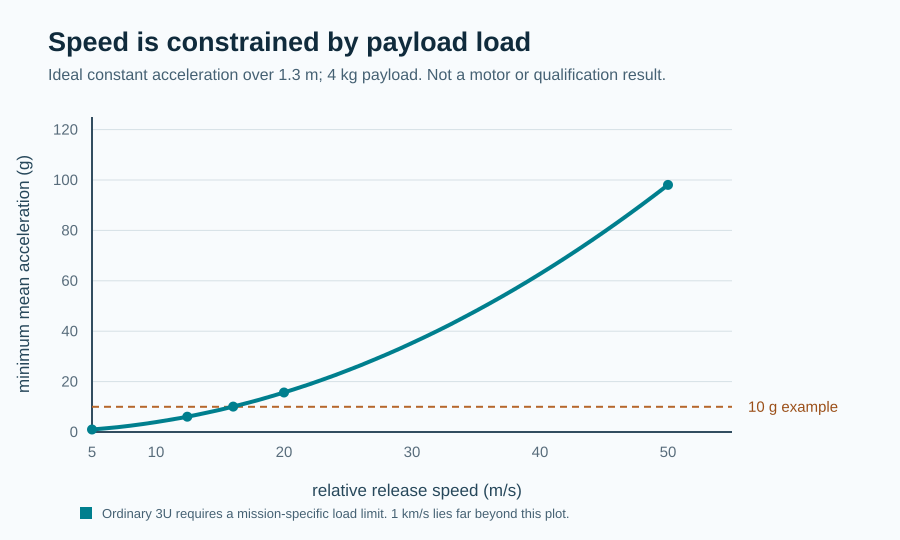

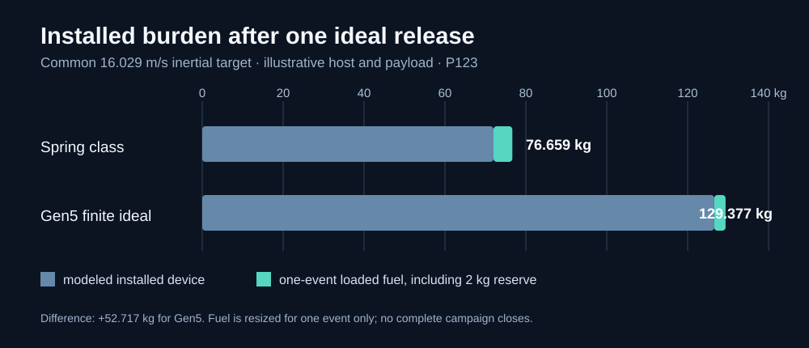

<p align="center"> 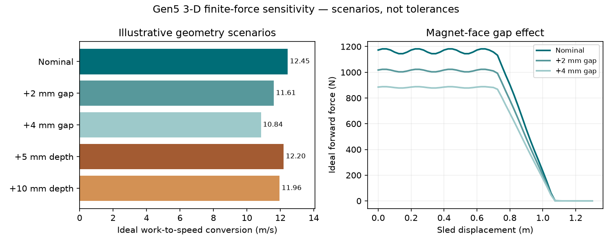</p>

*The 3-D formulations share geometry, remanence and ideal phase. The sensitivity cases are deterministic scenarios, not measured tolerances or statistical uncertainty.*

<p align="center">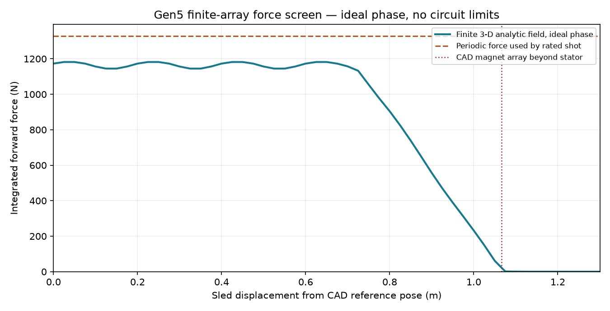 </p>

*The mission comparison uses the same modeled host, payloads and delivery target for a spring class and two Gen5 model speeds. No sampled twelve-shot case closes. [Exact reference inputs](docs/MATCHED_MISSION_REFERENCE.md).*

<p align="center"> </p>

*Open-source solver and model outputs, not physical measurements. [P119](validation/P119_gen5_finite_force_fem2d.md) gives mesh and boundary checks; [P120](validation/P120_gen5_finite_coupled_shot.md) states the two copper-energization branches.*

<p align="center">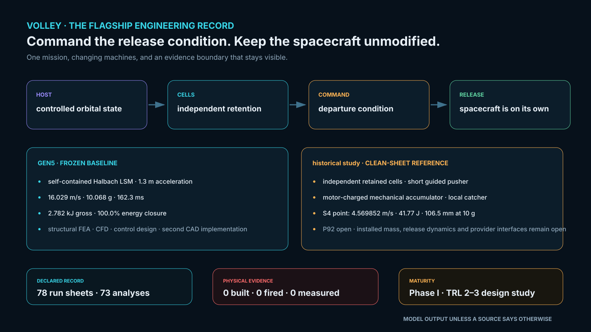</p>

*Architecture figure from this repository. Host operations and payload interface are conceptual and provider dependent.*

**Start here:** [Paper PDF](paper/VOLLEY_IEEE_Conference.pdf) · [LaTeX source](paper/paper.tex) · [Remaining CAD and IEEE work](IEEE_AND_CAD_REMAINING_WORK.md) · [IEEE prior-art update](IEEE_PRIOR_ART_UPDATE_2026-10-09.md) · [Claim audit](CLAIM_CORRECTIONS_2026-10-09.md) · [Computational review PDF](reports/GEN5_COMPUTATIONAL_REVIEW.pdf) · [FreeCAD/CAD review PDF](cad/GEN5_CAD_REVIEW.pdf) · [Artifact checksums](ARTIFACT_MANIFEST.sha256) · [Build notes](paper/README.md) · [Market and spacecraft fit](MARKET_AND_CUSTOMER_FIT.md) · [Claim provenance](PROVENANCE.md) · [Baseline](BASELINE.md) · [Validation register](validation/README.md)

## What the paper actually establishes

Gen5 models a magazine-fed, reusable-sled electromagnetic deployer for twelve unmodified 3U CubeSats on a host platform. The release station is 1.5 m from the breech on 1.8 m structural longerons; the powered stroke is 1.3 m. The design includes a double-sided Halbach linear motor, pulse-energy store and eddy-current sled arrest. A qualified host, complete release mechanism and flight interface have not been selected.

| Reported quantity | Gen5 result | How to read it |
|:--|--:|:--|
| Historical modeled 3U exit speed | **16.029 m/s** | Periodic model output contradicted by finite geometry; not a proven command envelope |
| Finite-force model screen | **12.448 m/s; 2.099 kJ gross** | Ideal phase and historical full-winding bank assumptions; not a rating |
| Modeled acceleration | **10.07 g** | Payload-specific structural compatibility unproven |
| Gross shot energy | **2.78 kJ** | Circuit and dynamics model of the historical shot |
| Dry / loaded mass | **126.6 / 174.6 kg** | Modeled rollup with a historical Gen3 sled solid-volume input and assumed components; installed host system not closed |
| Exit-speed dispersion | **0.0274 m/s (3σ)** | Closed-loop simulation with assumed sensor and uncertainty terms |
| 3U deployer mass per satellite | **10.547 kg** | Fails the stated roughly 2 kg/satellite economic criterion |
| Single-shot orbit case | **28.8 km** semi-major-axis rise; **1.60×** modeled lifetime | Stated 450 km, mean-activity case; lifetime result has not been independently rerun for that assumed historical input |
| Side-fed CAD reference fit | **11 mm width shortfall** | FreeCAD and CadQuery STEP intersection also finds 32,915 mm³ clash per cassette; feeder redesign needed |

See [baseline field names](BASELINE.md), [method limits](PROVENANCE.md), [decision gates and open problems](EVIDENCE_LIMITS.md). The approximately 6 kg/3U canister comparison is a separate incumbent-hardware parity test; it also fails (10.547/6 ≈ 1.76). These are two different decision boundaries.

<p align="center"> </p>

*Generated from this repository's [mass](analysis/results/mass_properties.json), [historical shot](analysis/results/motor_results.json) and [energy audit](analysis/results/rated_energy_mass_audit.json) outputs by the local [plot script](tools/plot_gen5_decision.py). Neither is a measurement. [P117](validation/P117_rated_energy_mass_audit.md) reconciles the old 124.488 J compact-output remainder to assumed converter loss, auxiliaries and a numerical step; actual power hardware remains unverified.*

<p align="center"> 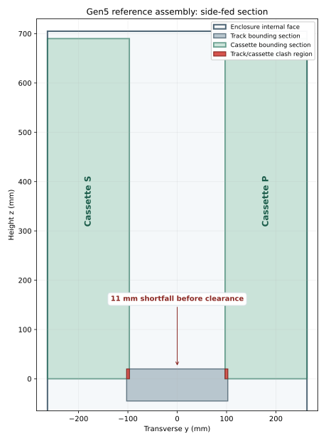</p>

*The separate Cartesian calculation recovers **28.800775 km** of immediate axis rise; it does not verify lifetime. The side-fed [native FreeCAD project](cad/native/Gen5_Review.FCStd) and [assembly STEP](cad/step/gen5/VOLLEY_Review_Assembly_FreeCAD_Gen5.step) retain a measured track/cassette clash. [Orbit method](validation/P115_rated_orbit_cartesian.md) · [CAD report](cad/GEN5_CAD_REVIEW.pdf).*

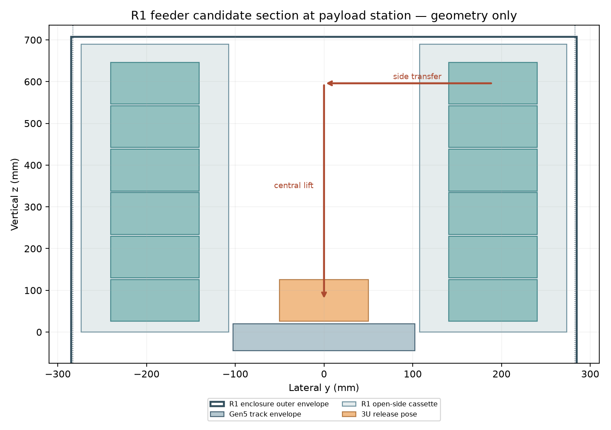

<p align="center"> </p>

*Left: failed Gen5 reference placement. Right: separate R1 widened geometry candidate; its actuation and installed system remain open. [Exact-solid audit and render provenance](cad/renders/step_review/README.md).*

The [P126 R1 tolerance screen](cad/FEEDER_R1_TOLERANCE_SCREEN.md) finds 1.31 mm residual for an assumed 0.2° alignment band and −0.47 mm for 0.5° against the R1 CAD-derived 5 mm nominal side gap. These bands are illustrative; moving hardware and flight tolerances remain unselected.

*The [R1 FreeCAD/STEP candidate](cad/FEEDER_CANDIDATE_R1.md) clears a scripted 3U envelope path in a widened enclosure. It has no lift actuator, launch retention, tolerance closure or revised installed budget, and is not the evaluated Gen5 baseline.*

<p align="center">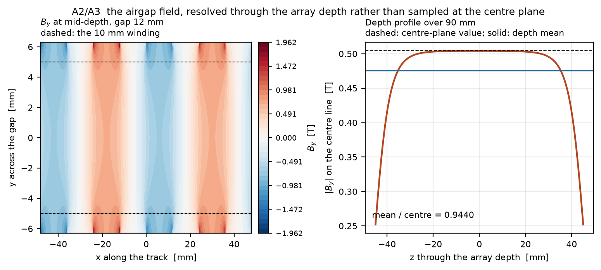 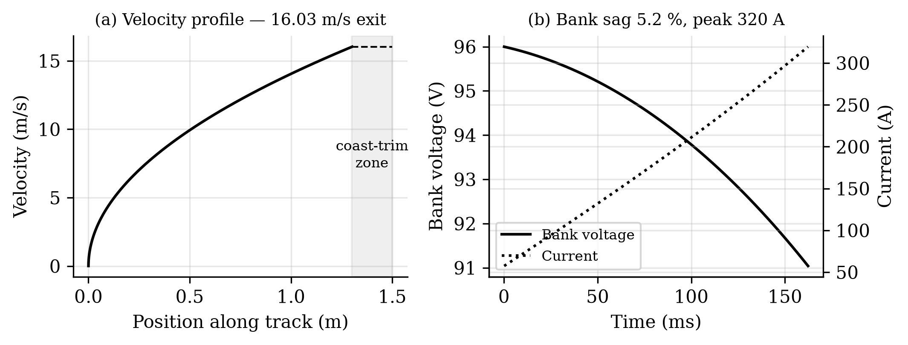 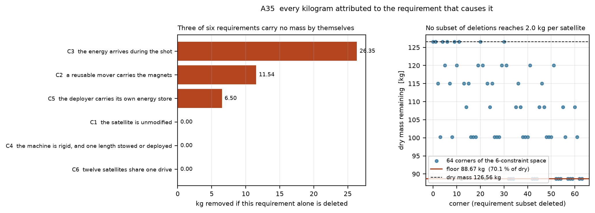</p>

*Field → shot → mass floor. The numerical field cross-check applies to selected quantities, not to the entire machine. The mass-ledger result is a negative finding, not a design endorsement.*

## Evidence levels

| Level | Present evidence | Limit |
|:--|:--|:--|
| Model calculation | Shot, orbit, control, thermal, mass and CAD outputs in [analysis](analysis/) and [cad](cad/) | Depends on assumed inputs and geometry |
| Independent numerical cross-check | Selected field, circuit and orbital calculations in [validation](validation/) | Checks defined model aspects and cases only |
| External literature or products | [Prior art](PRIOR_ART.md), [literature](LITERATURE.md), bibliography in the manuscript | Supports comparison and assumptions; does not validate Gen5 hardware |
| Physical qualification | **None** | Release repeatability, loads, feeder, recoil, environmental and host acceptance remain open |

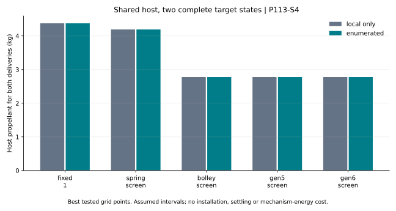

*The timing figure is a sampled mission study. Its 4.57 m/s best point is not an achieved launcher setting, a maximum speed or a full twelve-payload mission result.*

## Reproduce the published model point

```bash
python3 -m pip install -r requirements.txt
cd analysis
python3 verify_field.py
python3 mass_properties.py
python3 motor_model.py
python3 sizing.py
python3 payload_family.py
python3 astro.py
python3 comparators.py
python3 cost.py
```

Outputs are written under [analysis/results](analysis/results/). Run in the listed order because downstream analyses read the rated shot from `motor_results.json`. The cited artifact is the checked-in result set; dependency and solver availability may affect a new run. [Build both paper page sizes](paper/README.md) and [regenerate figures](paper/make_figures.py) from local sources.

Run `python3 tools/check_review_surface.py` for the repository's fast integrity gate: current local links, manuscript figures, key captured-result identities, artifact hashes and the compiled PDF. It does not independently validate electromagnetic thrust or certify a host interface. Some older, copied validation sheets contain programme-history links outside this companion; current manuscript claims must trace to local sources named above.

## Package map

| Path | Purpose |
|:--|:--|
| [paper/](paper/) | Authored LaTeX, figures and current Letter PDF |
| [print/](print/) | Current A4 and Letter handover PDFs |
| [analysis/](analysis/) | Executable models and captured JSON results |
| [validation/](validation/) | Predeclared run sheets, cross-checks and failures |
| [cad/](cad/) | Gen5 source parts, eight FreeCAD-exported STEP parts, native FCStd assembly, failure report and rendered views |
| [reports/](reports/) | Local seven-page computational evidence review and its source |
| [BASELINE.md](BASELINE.md), [PROVENANCE.md](PROVENANCE.md), [EVIDENCE_LIMITS.md](EVIDENCE_LIMITS.md) | Claim values, evidence classes and unresolved decisions |

The analysis and reference records began as a dated engineering snapshot and now include local P115/P116 checks and FreeCAD exports. This copy is the evidence package for the manuscript; later changes elsewhere do not silently change its claims. The manuscript and PDFs are authored here. Any future update requires rerunning the local checks and recording the changed sources. [VOLLEY engineering](https://github.com/aaaaaaaaaaaavm/VOLLEY), [college thesis](https://github.com/aaaaaaaaaaaavm/VOLLEY-thesis) and [research vault](https://github.com/aaaaaaaaaaaavm/VOLLEY-lab) provide optional programme context.
