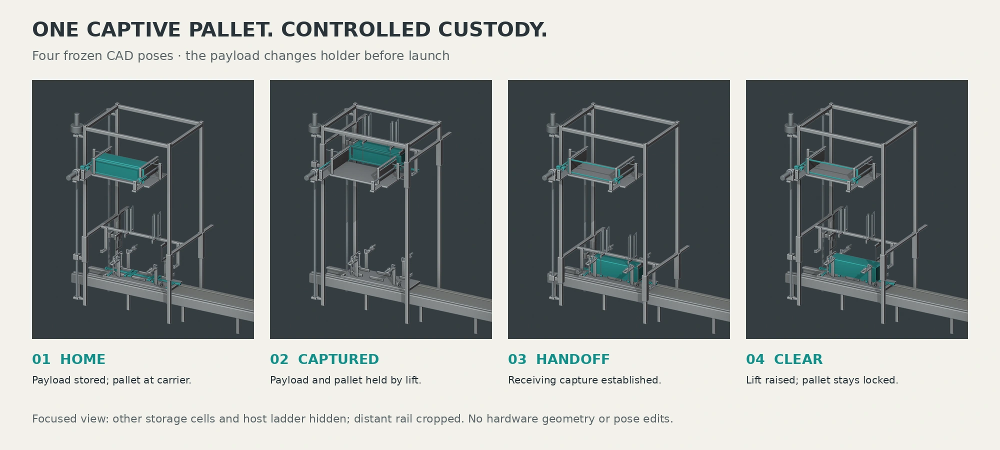

# VOLLEY — Research Manuscript
### Design and Computational Evaluation of a Commanded Electromagnetic CubeSat Deployment Mechanism

**Adityavardhan Mishra and Pratham Chawla** 
Mechanical Engineering · Symbiosis Institute of Technology, Pune

**[Read the manuscript · 9 pages](current/academic/paper/paper.pdf)** · [LaTeX source](current/academic/paper/paper.tex) · [Methods and data](current/RESULTS.md) · [Reproduce the study](current/REPRODUCE.md)

**Manuscript status:** IEEE-formatted research draft, unsubmitted; venue unselected. Engineering configuration: **VOLLEY-G5-ACR1**. Editorial edition: **ED1**.

*CAD-derived Blender render · Gen5 ACR1 home state. [Geometry and render provenance](figures/acr1-polish/POLISH_PROVENANCE.json).*

## Research question

How does a commanded electromagnetic release mechanism perform when storage, payload custody, finite motor geometry, electrical supply, carrier recovery and host mission resources are evaluated together?

VOLLEY evaluates a twelve-payload reference with **4 kg 3U envelope surrogates**, **1–3 m/s commanded release cases** and **1.300 m powered travel**. The host provides major orbital manoeuvres; the deployer sets each local departure condition.

## Contribution

The contribution is a reproducible, integrated retained-carrier computational reference. Programmable electromagnetic separation is established prior art. This study connects the selected mechanical cycle to finite force, source-limited launch and arrest, installed mass and same-target orbital delivery.

| Evidence | Captured result | Local source |
|:--|:--|:--|
| Mechanical integration | Eight native/STEP states; 154 accepted sampled motion/refinement cases | [CAD and checks](current/cad/release/) |
| Electrical and mechanical coupling | Nominal/adverse source cases with finite position-dependent force, current, back-EMF, recoil and arrest | [Shot source](current/analysis/coupled_shot.py) · [Case results](current/analysis/COUPLED_SHOT.json) |
| Numerical force comparisons | Alternative source-face and actual-conductor-current calculations under stated shared field assumptions | [Finite motor](current/analysis/FINITE_MOTOR.json) · [Current-field comparison](current/analysis/CURRENT_FIELD_FORCE.json) |
| Custody logic | 24 accepted nominal commands; 166 declared tests | [Interlocks source and results](current/analysis/TRANSFER_INTERLOCKS.json) |
| Installed resources | 149.557 kg represented dry CAD + 7 kg electrical/control allowance | [Resource ledger](current/analysis/RESOURCE_LEDGER.json) |
| Orbital delivery | Matched twelve-release campaigns and native Orekit numerical replay | [Inputs](current/mission/MISSION_INPUTS.json) · [Results](current/mission/MISSION_RESULTS.csv) · [Replay checks](current/mission/NATIVE_REPLAY_CHECKS.json) |

## System and principal finding

*CAD-derived mechanism sequence. [Feeder interface](figures/acr1-polish/feeder_detail_annotated.png) · [Configuration parameters](current/cad/PARAMETERS.json).*

The source-coupled model supports the declared low-speed reference cases. Mission outcomes depend on target family and host authority: the tested preplanned campaigns establish **no propellant or initial wet-mass advantage over ideal ground-pretrimmed springs**. This identifies the installed-resource challenge for subsequent development rather than assuming that adjustable speed alone creates a service advantage.

The results are computational. Numerical agreement is reported with its shared assumptions; physical release dispersion, reliability, environmental qualification and provider acceptance require measurements and integration evidence.

## Reproducibility and data

This repository includes the manuscript figures, engineering inputs and source, all eight native CAD/STEP/BOM states, and the indexed 60-member raw solver supplement. Selected numerical examples run from this checkout without the main VOLLEY repository.

1. Follow the [build and reproduction guide](current/REPRODUCE.md).
2. Use the [chapter/figure map](current/ACADEMIC_MAP.md) to trace claims to local evidence.
3. Inspect the [full-text prior-art comparison](current/academic/evidence/literature/FEEDER_FULL_TEXT_REVIEW_2026_10_19.md) and [ED1 citation review](current/academic/evidence/literature/ACR1_EDITORIAL_REVIEW.md).
4. Verify the captured identities with `python3 tools/check_acr1.py`.

The [original dated issue](archive/2026-10-24-acr1-original/README.md) preserves the original manuscript and academic source. ED1 corrects bibliography identities while retaining the engineering argument and results. The local [companion report and presentation](current/academic/README.md) document that same capture.

[Scientific figure conventions](docs/FIGURE_STANDARD.md) · [Verification receipt](VALIDATION_CURRENT.json) · [Citation](CITATION.cff) · [Licensing and third-party rights](LICENSING.md) · [Edition and errata policy](RELEASE_POLICY.md)
